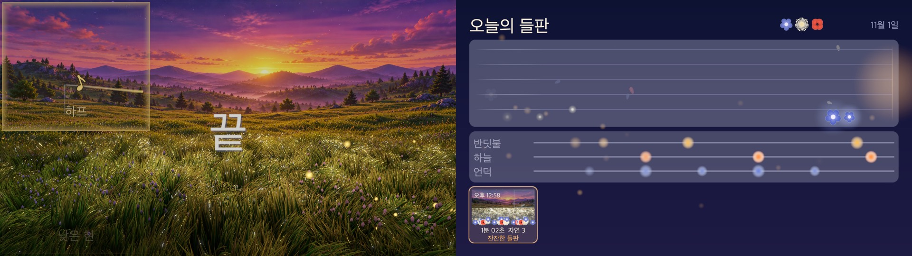
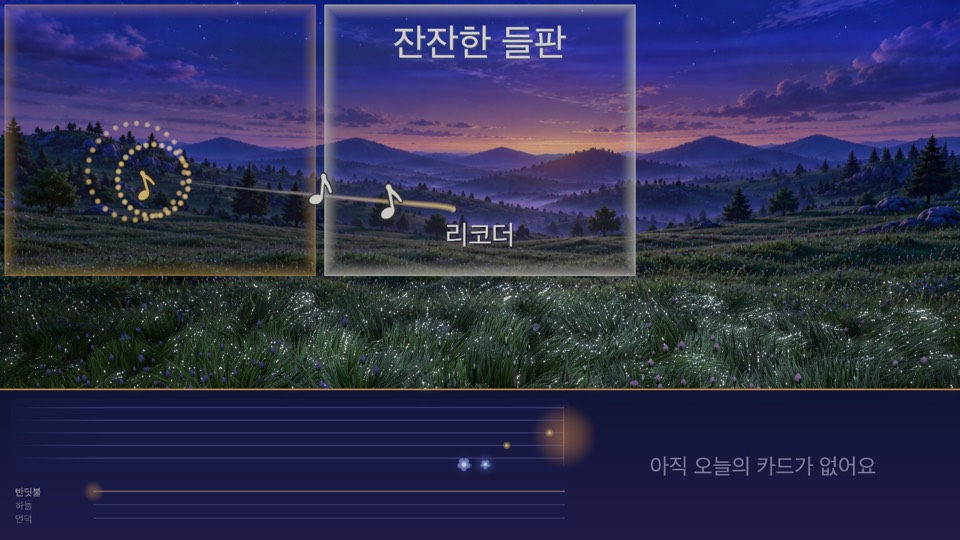
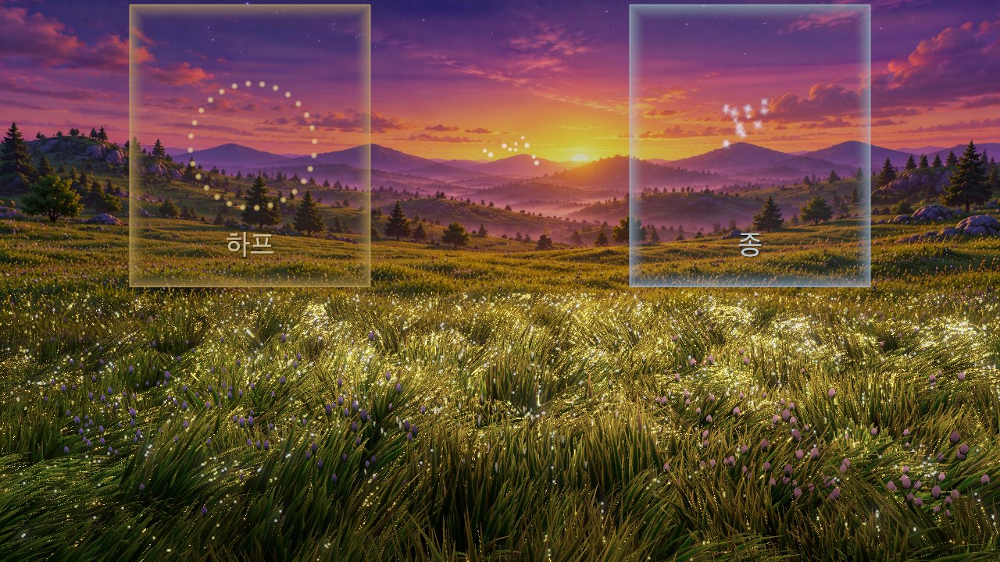
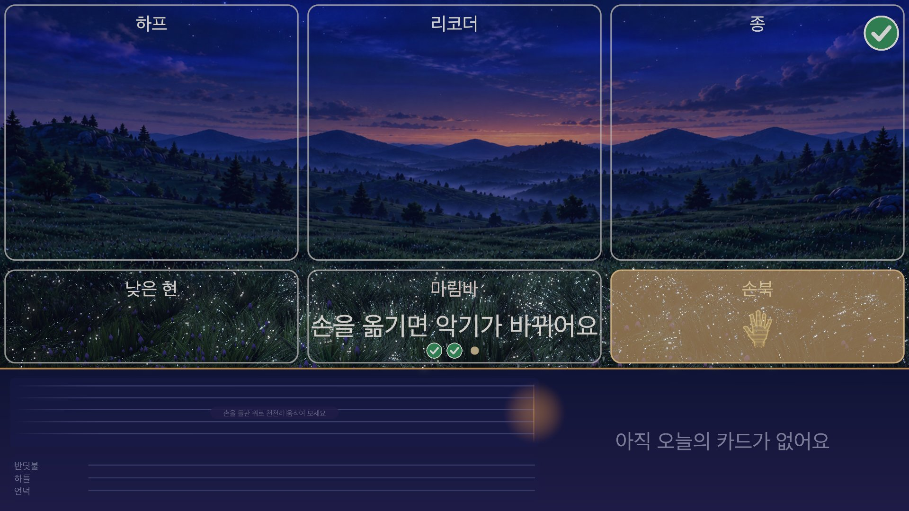

# 들판 오케스트라 (Downbeat)

웹캠 앞에서 손을 움직이면, 해 질 녘 3D 들판이 박자에 맞춰 연주되는 Unity 개인 시제품입니다.

*A personal Unity prototype: move your hands in front of a webcam and a 3D meadow at dusk plays music on the beat.*

- 시연 영상: https://youtu.be/jWMInxaSkUs (Windows 노트북 웹캠으로 실제 연주)
- 기간: 2026.10.28~
- 사용 기술: Unity 6 URP, C#, VContainer / Python, MediaPipe Hand Landmarker



| 곡이 시작될 때 | 위 줄 손: 하늘 이펙트 | 따라 하기 안내 |
|---|---|---|
|  |  |  |

## 무엇을 하나요

- **6칸, 악기 6개**: 화면이 위아래 2줄 x 좌우 3칸이고, 칸마다 악기가 하나씩 있습니다(위: 하프, 리코더, 종 / 아래: 낮은 현, 마림바, 손북). 손을 크게 움직일수록 소리가 커지고 음이 촘촘해지며, 소리는 박자(96 BPM)에 맞춰 납니다.
- **곡 모드**: 방문마다 곡 3개를 차례로 칩니다. 위 줄 손은 가락을, 아래 줄 손은 화음을 냅니다. 곡이 끝나거나 두 주먹을 벌리면 곡 이름이 적힌 카드가 기록 화면에 쌓입니다. Tab 설정 창에서 자유 연주로 바꿀 수 있습니다.
- **들판의 반응**: 아래 줄 손 밑에서는 풀이 눕고 꽃이 피고, 위 줄에서는 하늘에 빛이 생깁니다. 오래 세게 연주하면 하늘이 노을까지 갑니다. 연주가 멈추고 10초가 지나면 따라 하기 안내가 나옵니다.
- **화면 2대**: 한쪽은 들판, 한쪽은 꽃 악보와 '오늘의 들판' 카드가 쌓이는 기록 화면입니다. 모니터가 1대면 기록 화면이 들판 아래에 띠로 나옵니다.
- **개인정보**: 카메라 영상은 손 추적 앱 안에서만 쓰고 저장하지 않습니다(시연 영상용 `-SaveVideo` 옵션 제외). Unity 앱은 손 좌표만 받습니다. 손 인식 라이브러리(MediaPipe)가 구글로 보내는 사용 통계는 [`docs/windows-hand-setup.md`](docs/windows-hand-setup.md) 8절에 적었습니다.

## 구조

```
웹캠 → 손 추적 앱 (Python, MediaPipe; 카메라 영상은 여기서만)
          │ 손 좌표만 (UDP)
          ▼
       Unity 들판 앱 (박자 격자, 손짓 해석, 곡, URP 들판) → 화면 2대 + 소리
감시 앱: 두 앱을 켜고, 멈추면 다시 켭니다. 상태 로그: 1분마다 CSV, 5초마다 하트비트
```

| 폴더 | 내용 |
|---|---|
| [`unity/Downbeat/`](unity/Downbeat/) | Unity 프로젝트 |
| [`tracker/`](tracker/README.md) | Python 손 추적 앱 |
| [`supervisor/`](supervisor/README.md) | 감시 앱 |
| [`content/`](content/) | 곡, 악기, 들판 값, 소리, 배경 그림(다시 빌드하지 않고 바꿈) |
| [`docs/`](docs/) | 설계, 측정 방법, Windows 실행 안내 |
| [`measurements/`](measurements/) | 문서에 적은 숫자의 원본 |

## 현장을 생각해 먼저 시험한 것

- **약한 노트북에 맞춘 연주 방식**: 내장 그래픽 노트북(i7-10610U)에서 손 추적이 초당 6장까지 떨어지자, 손을 내려치는 순간을 재는 방식으로는 첫 1분에 음이 하나도 나지 않았습니다. 그래서 지휘하듯 연주하는 방식으로 바꿨습니다. ([기록](docs/conducting-play.md))
- **설정 없이 맞춰지는 화질**: 그래픽 장치 이름과 첫 8초로 화질을 고르고, 실행 중에는 느려지면 렌더 배율을 낮춥니다.
- **다시 빌드하지 않는 콘텐츠 교체**: 곡, 악기, 들판 값은 실행 파일 옆 `content` 폴더에 둡니다. 파일이 깨지면 마지막 정상본이나 기본 내용으로 시작하고 이유를 로그에 남깁니다.
- **멈춰도 다시 켜기**: 감시 앱이 응답이 끊긴 앱을 다시 켭니다. 그래픽 장치를 잃거나 화면이 20초 넘게 멈추면 앱이 스스로 꺼져 바로 다시 켜지게 했습니다(Windows에서 다시 확인하기 전). ([감시 앱](supervisor/README.md), [밤샘 기록](docs/windows-soak-2026-11-02.md))

## 측정

| 값 | 결과 | 조건 |
|---|---|---|
| 약한 노트북 손 추적 | 초당 6장(중앙값) | i7-10610U 내장 그래픽, 다른 프로그램이 CPU를 나눠 쓸 때. [원본](docs/conducting-play.md) |
| 밤샘 구동(앱 혼자) | 6시간 57분 오류 없음, 그 뒤 그래픽 드라이버 재시작으로 멈춤 | 같은 노트북, 녹화한 손 움직임으로 연주, 화면 평균 29.9장/초, 늦은 음 0, 메모리 증가 거의 없음. [원본](docs/windows-soak-2026-11-02.md) |

## 어떻게 만들었나요

구현은 AI 코딩 도구(Claude Code)로 했습니다. 저는 무엇을 만들지와 연주 규칙, 받아들일 기준을 정하고, 테스트와 Windows 노트북 직접 연주를 통과한 것만 받아들였습니다. 제가 정한 것의 예:

- 캐릭터 단원 대신 **자연이 주인공**인 들판, **꽃 종류로 악기를 나누는** 배치 ([설계](docs/superpowers/specs/2026-10-29-meadow-orchestra-design.md))
- **지휘 연주 규칙**: 위아래 2줄 x 3칸, 움직임 크기 = 소리 크기, 두 주먹으로 끝내기 ([설계](docs/superpowers/specs/2026-10-31-conduct-six-cells-design.md))
- **곡 모드**: 위 줄은 가락, 아래 줄은 화음, 자유 연주는 Tab 스위치로 남기기 ([설계](docs/superpowers/specs/2026-11-01-song-mode-design.md))

## 실행

실행 파일은 저장소에 들어 있지 않습니다. 웹캠과 Python 손 추적 앱이 필요합니다.

- **Windows**: [손 추적 설치](docs/windows-hand-setup.md), [실행과 측정](docs/windows-runbook.md)
- **Mac**: [`ops/mac/run-demo.command`](ops/mac/run-demo.command) (카메라가 없으면 녹화한 손으로 연주)
- **빌드**: [`tools/unity_build.sh`](tools/unity_build.sh)

## 라이선스

코드는 MIT([`LICENSE`](LICENSE)), 외부에서 온 소리/그림/모델의 출처는 [`NOTICE`](NOTICE)에 있습니다. 곡 "잔잔한 들판"과 "밝은 아침"은 AI(Claude)로 작곡했고, "올드 랭 사인"은 스코틀랜드 전승 선율(공유 저작물)을 편곡했습니다.
